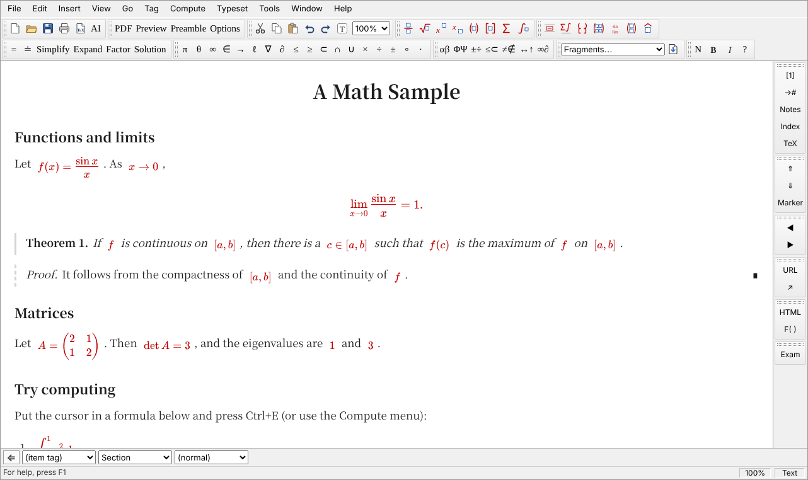
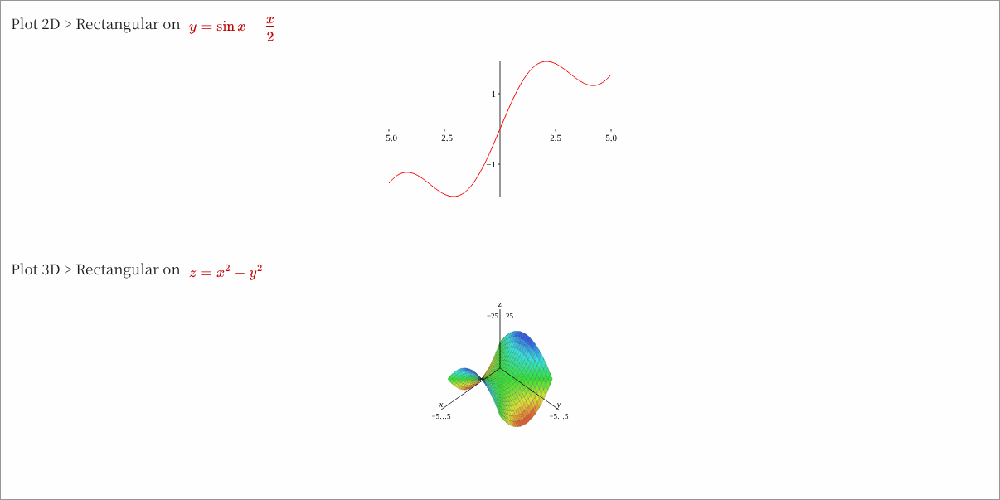

# opensw

**English** | [繁體中文](README.zh-TW.md)

opensw is an open-source math editor rebuilt after Scientific Word 5.5 (a program for writing mathematical documents). It is for people who still work in 5.5 or have 5.5 files.

Plenty of people still write their mathematics in 5.5, but it gets harder to run on today's computers.
opensw aims at one thing: open 5.5 files, edit them, typeset them, and work the way 5.5 does.

Formulas can be computed from the Compute menu: simplify, solve, calculus, matrices, plots. The Windows version comes with the programs that do the computing, so there is nothing else to install and no internet connection is needed.

The code is written from scratch, and opensw is not a product of the makers of Scientific Word (see "Acknowledgments" at the end).





More pictures are in the manual (Help > Full manual).

## What it does

- Opens Scientific Word 5.x `.tex` files and 6.x `.sci` files
- The desktop app works on a copy: opening a file imports it (the file and the files it uses are copied into `Desktop\opensw projects\<name>_<date>\`), and saving writes the copy, not the file you opened (an AI saves only in the projects folder, so it can never write that file; you can, by choosing it yourself in Save As); the status bar shows where the copy is
- Each such folder keeps three plain-English records: a change log (the import, every AI change with the text before and after, every save), a file map, and the handoff notes an AI leaves for whoever goes on with the work
- 5.x `.tex` is the main format: saves back to the same file (keeping a `.bak`; Chinese in Big5) writing only the edited paragraphs again and leaving the rest exactly as it was, typesets from that same text, and can also save `.sci`
- Text and formulas on the same line; menus and keyboard shortcuts as in 5.5: of the 313 menu items of 5.5, opensw has 298, and the other 15 do not apply (window arrangement, registration, licence information, DVI and the like)
- A Compute menu: simplify, solve, calculus, matrices, ODEs, statistics (what does the computing: see "Computing" below). Computing is opensw's own (5.5 used MuPAD), so answers may be written differently from 5.5's
- Tables, pictures, footnotes, citations, index entries, cross-references, numbered equations
- 5.5 plots are drawn again from the settings stored in the file (all the 2D and 3D kinds)
- Demo problems: File > Samples has three demo documents (calculus, algebra and matrices, vectors and statistics and more); each problem names its menu command and gives the answer, to try the Compute menu on
- Exam Builder: exams and answer keys made from a 5.5 exam template (.qiz)
- Fragments, Open Location, Document Manager (pack into a .zip, open 5.5's wrapped .rap)
- A manual for every menu, with pictures: Help > Full manual (source in `src/helpdoc.js`, pictures in `public/manual`)
- Typesets to PDF (XeLaTeX, Chinese included; the Windows version bundles Tectonic and the usual TeX files, so it works offline); exports LaTeX, HTML and Markdown
- Interface in English and Traditional Chinese (Tools > User Setup). The program is written in English; Chinese is the translation file `src/locales/zh-TW.json`; to add a language, see the top of `src/i18n.js`
- In the desktop app, Claude or ChatGPT can work on the document: Tools > Connect AI sets it up in one step; what the AI changed is tinted, and Edit > Undo AI Changes takes it back in one step
- The desktop app has an MCP server, so AI tools can read, edit, compute and typeset; the same commands work from a terminal with `opensw-cli` (see docs/AI.md)
- An AI can check a derivation step by step: each displayed formula is a step with a fixed name, the steps it uses are recorded, and the computation engine checks each one (a step with an indefinite integral that is right up to a constant is left undecided, not passed); names and results are kept in a file beside the document, which is not changed (see docs/AI.md)

A 5.x command it does not know is kept as a TeX field, so nothing is lost on saving or export.

## Computing

In the Windows desktop app, three open-source programs do the computing, and all three come with opensw. There is nothing to choose and nothing to set up.

- SymPy: a symbolic computation program written in the Python language (symbolic computation gives formulas, such as a factorization or an integral, not only numbers). It can do every command of the Compute menu. opensw comes with Python 3.13 and SymPy 1.14 to run it.
- Giac: another open-source symbolic computation program. Integrals (indefinite, definite, multiple), power series, and determinants of 4 or more rows with letters in them go to Giac first.
- FriCAS: also an open-source symbolic computation program. An indefinite integral that Giac does not find goes to FriCAS, and to SymPy only when FriCAS has no answer either.

The order for an indefinite integral is Giac, FriCAS, SymPy. An answer from Giac or FriCAS is checked before it is used: with numbers, and for an integrand with a root of a square or an absolute value in it (where such a program may give an answer that holds on part of the line only) by proving that its derivative is the integrand; opensw still writes the answer out, following 5.5's habits.

Examples measured on the laptop used for testing:

- ∫ x⁵ e²ˣ sin 3x dx: from about 3 seconds to about 0.3 seconds (Giac).
- ∫ √(1 + sin x) dx and ∫ 1/((1 + x²)√(1 − x²)) dx: these used to come back unchanged and now have an answer (FriCAS).

Versions up to 0.10.0 ran SymPy in Pyodide (Pyodide runs Python inside a web page), which is slower. When the Python that comes with opensw does not start, opensw goes back to that way by itself and tells you once. The web version opened in a browser also works that way, with SymPy only.

Mathematica (a commercial mathematics program) is optional: if you have it, you can choose it in Tools > Engine Setup. Mathematica then computes first, and what it does not do goes to the programs above. Every computing feature works without Mathematica.

Bessel functions are written as in 5.5 by default: J_v(z) and the like (I, J, K, Y with a subscript) are read as Bessel functions only when "Use I, J, K, and Y with Subscripts" is checked in Compute > Settings.

To connect another engine: [ENGINE.en.md](ENGINE.en.md).

## Download

Windows 10 and 11: download from the [Releases page](https://github.com/chauchikin/opensw/releases).

- `opensw_<version>_x64-setup.exe`: the installer. It installs into your own user folder and needs no administrator rights.
- `opensw_<version>_x64-portable.zip`: the portable version. Unzip it first (right-click it, then Extract All; opensw.exe does not run from inside the zip), then run `opensw.exe` in the folder; it can live on a USB stick.

For 0.12.0 the installer is about 115 MB and the portable zip about 168 MB (about 420 MB unzipped); most of that is the Python, Giac and FriCAS that come with it (the 0.8.x installer was about 41 MB).

The installer is not signed, so the first time Windows may say "Windows protected your PC". Click "More info", then "Run anyway".

There are no installers for macOS and Linux; you can build it yourself as described under "Running it".

## Running it

```
npm install
npx vite              # development server (http://localhost:5173)
npx vite build        # web version in dist/
npx tauri build       # desktop app (needs Rust)
```

Tests are in `test/` and run with Playwright's Chromium. Build, start the preview, then run all of them or a few:

```
npx vite build
npx vite preview --port 4173 &
npm test              # all
npm test tables       # only test/tables.mjs
```

## License

Mozilla Public License 2.0 (MPL-2.0), see [LICENSE](LICENSE). This is the same licence family as the open-source Scientific Word 6 (MPL 1.1, which allows moving to 2.0).

In short: you may use, change and pass on opensw, also commercially. If you change one of opensw's files and give the program to others, that file's source stays open under MPL-2.0; files of your own can have any licence. Versions up to 0.8.0 were released under MIT.

Components keep their own licenses: ProseMirror, MathLive, CortexJS Compute Engine (MIT), SymPy, mpmath (BSD), Pyodide (MPL-2.0), Python (PSF), giacpy and Giac (GPL-2.0-or-later, GPL-3.0-or-later; run as a separate process), python-flint and FLINT (MIT, LGPL) and FriCAS (BSD) in the Windows desktop app, with the libraries that come inside them (GPL, LGPL, OpenSSL and others; all listed in [THIRD-PARTY-NOTICES.txt](THIRD-PARTY-NOTICES.txt)), Tauri (MIT/Apache-2.0), Tectonic (MIT). The full texts are in [THIRD-PARTY-NOTICES.txt](THIRD-PARTY-NOTICES.txt), which also ships with the installer. Regenerate it with `node scripts/licenses.mjs` after changing dependencies.

## Citing opensw

GitHub's "Cite this repository" button (from [CITATION.cff](CITATION.cff)) gives the reference in APA and BibTeX.

## Acknowledgments

Scientific Word was made by MacKichan Software. For many years it let people write mathematics well, and opensw follows its menus, shortcuts and file formats. Thank you.

opensw's code is written from scratch. It uses no Scientific Word code, icons or sample files. How the 6.x `.sci` format is read and written was worked out from the public source code of Scientific Word 6 ([ScientificWord/mozilla](https://github.com/ScientificWord/mozilla)).
To typeset 5.x documents it uses 5.x's macro files (tcilatex and others). The ones shipped with opensw are only those whose files say they may be freely copied and distributed; the others are replaced by versions written for opensw. If 5.x is installed on your computer, your own copies are used first.

opensw is not affiliated with MacKichan Software and is not one of its products. Scientific Word is a trademark of MacKichan Software.
