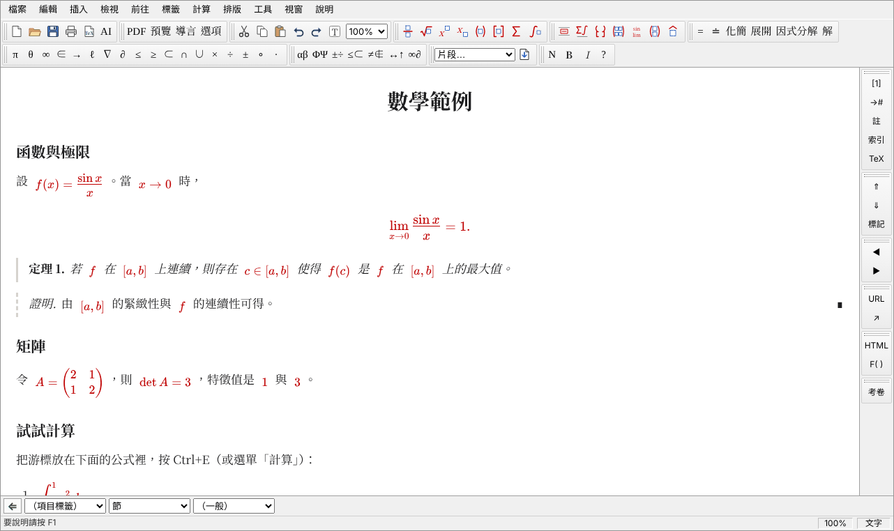
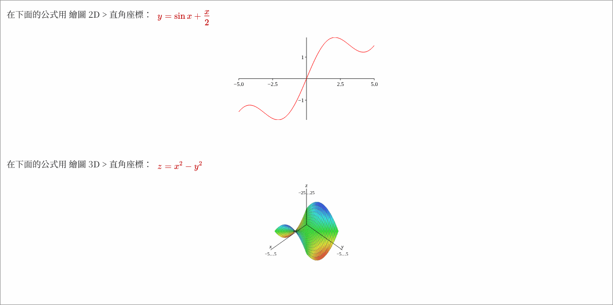

# opensw

[English](README.md) | **繁體中文**

opensw 是照 Scientific Word 5.5（寫數學文件用的軟體）重做的開源數學編輯器，給還在用 5.5、或手上有 5.5 檔案的人用。

還有不少人在用 5.5 寫數學文件，可是它在現在的電腦上越來越難跑。
opensw 想做的事很簡單：5.5 的檔案打得開、改得動、排得出來，用法跟 5.5 一樣。

公式可以直接用計算選單算：化簡、解方程、微積分、矩陣、畫圖。Windows 版把計算用的程式都附在裡面，不用另外安裝，也不用連網路。

程式是重新寫的，opensw 不是 Scientific Word 原廠的產品（見最後的「致謝」）。





更多圖在說明文件裡（說明 > 完整說明文件）。

## 能做什麼

- 打開 Scientific Word 5.x 的 `.tex` 和 6.x 的 `.sci`
- 桌面版編輯的是複本：開啟檔案就是匯入（檔案和它用到的檔案複製到 `桌面\opensw projects\<檔名>_<日期>\`），存檔寫的是複本，不是你開的原檔（AI 只能存在專案資料夾裡，所以永遠寫不到原檔；你自己在另存新檔選它才會寫）；狀態列顯示複本放在哪裡
- 每個這樣的資料夾有三份白話英文紀錄：修改紀錄（匯入、AI 每次修改的前後文字、每次存檔）、檔案地圖、AI 留給接手者的交接筆記
- 以 5.x 的 `.tex` 為主：存回同一個檔（先留 `.bak`，中文用 Big5），只重寫改過的段落、其他照原檔一字不動，排版也用這份；也可以另存成 `.sci`
- 文字和公式混著打，選單和快捷鍵照 5.5：5.5 的選單共 313 項，opensw 有 298 項，其餘 15 項是用不上的（視窗排列、註冊、授權資訊、DVI 這類）
- 計算選單：化簡、解方程、微積分、矩陣、常微分方程、統計（用什麼算，見下面「計算」）。計算是 opensw 自己的功能（5.5 用 MuPAD），答案寫法不一定和 5.5 一樣
- 表格、圖片、註腳、引用文獻、索引、交叉引用、有編號的公式
- 5.5 的繪圖會照檔案裡的設定重新畫出來（2D、3D 各種繪圖都有）
- 示範題：檔案 > 範例 有三份示範文件（微積分、代數與矩陣、向量統計等），每題寫了用哪個選單指令和答案，可以照著試計算選單
- 考卷產生器：用 5.5 的考卷範本（.qiz）產生多份考卷和答案
- 片段、開啟網址、文件管理（打包成 .zip、開 5.5 的 .rap）
- 排成 PDF（XeLaTeX，可以排中文；Windows 版附 Tectonic 和常用的 TeX 檔，沒有網路也能排），也能匯出 LaTeX、HTML、Markdown
- 介面有英文和繁體中文（工具 > 使用者設定 切換）。程式的原文是英文，中文是翻譯檔 `src/locales/zh-TW.json`；要加其他語言，看 `src/i18n.js` 開頭的說明
- 桌面版可以讓 Claude、ChatGPT 控制文件：工具 > 連接 AI 一鍵設定；AI 改過的地方有底色，編輯 > 復原 AI 的修改 一次改回來
- 桌面版有 MCP，AI 可以直接讀、改、算、排版；同樣的指令也能用命令列 `opensw-cli` 下（見 docs/AI.md）
- AI 可以逐步檢查一份推導：每條獨立公式是一步、有固定的名字，記下它用到哪幾步，交給計算引擎逐步檢查（有不定積分的步驟，如果只差一個常數，不判對錯，不算通過）；名字和結果放在文件旁邊的檔，不改文件（見 docs/AI.md）

5.x 的指令遇到不認得的，會原樣留成 TeX 欄位，存檔和匯出都不會掉。

每個選單的說明（有圖）在程式裡：說明 > 完整說明文件（原文在 `src/helpdoc.js`，圖在 `public/manual`）。

## 計算

Windows 桌面版的計算由三個開源程式做，都附在 opensw 裡。使用者不用選、不用設定。

- SymPy：用 Python 這個程式語言寫的符號計算程式（符號計算是算出式子，例如因式分解、積分，不只是算數字）。計算選單的每個指令它都會做。opensw 附了 Python 3.13 和 SymPy 1.14 來跑它。
- Giac：另一個開源的符號計算程式。積分（不定積分、定積分、多重積分）、冪級數、4 列以上含字母的行列式，先交給它算。
- FriCAS：也是開源的符號計算程式。Giac 找不到的不定積分交給它，它也沒有答案才輪到 SymPy。

不定積分的順序是 Giac、FriCAS、SymPy。Giac 和 FriCAS 的答案要先驗過才採用：用數值驗算；被積函數裡有「平方再開根號」或絕對值的（這類式子它們可能給出只在一部分範圍成立的答案），還要能證明答案的導數就是被積函數；答案的寫法仍由 opensw 照 5.5 的習慣整理。

在測試的筆電上量到的例子：

- ∫ x⁵ e²ˣ sin 3x dx：從約 3 秒變成約 0.3 秒（Giac）。
- ∫ √(1 + sin x) dx 和 ∫ 1/((1 + x²)√(1 − x²)) dx：以前回原式，現在有答案（FriCAS）。

0.10.0 以前的版本，SymPy 是在 Pyodide 裡跑的（Pyodide 讓 Python 在網頁裡執行），比較慢。附的 Python 啟動不了時，opensw 會自動改回這個方式，並告訴你一次。用瀏覽器開的網頁版也是這個方式，只有 SymPy。

Mathematica（商業的數學軟體）是可選的：自己有 Mathematica 的人可以在 工具 > 計算引擎 選它，選了以後 Mathematica 先算，它不做的再交給上面附的程式。沒有 Mathematica 也能用全部的計算功能。

Bessel 函數的寫法預設和 5.5 一樣：J_v(z) 這類帶下標的 I、J、K、Y，要在 計算 > 設定 勾選「用加下標的 I、J、K、Y」才當成 Bessel 函數。

要接其他計算引擎，看 [ENGINE.md](ENGINE.md)。

## 下載

Windows 10、11：到 [Releases 頁面](https://github.com/chauchikin/opensw/releases) 下載。

- `opensw_<版本>_x64-setup.exe`：安裝檔，裝在自己的使用者資料夾，不用管理員權限。
- `opensw_<版本>_x64-portable.zip`：免安裝版，要先解開（在檔案上按右鍵，選「解壓縮全部」；直接在壓縮檔裡點 opensw.exe 不能用），再執行資料夾裡的 `opensw.exe`，可以放在隨身碟。

0.12.0 的安裝檔約 115 MB，免安裝版的壓縮檔約 168 MB、解開後約 420 MB；大部分是附的 Python、Giac 和 FriCAS（0.8.x 的安裝檔約 41 MB）。

安裝檔沒有數位簽章，第一次執行時 Windows 可能會顯示「Windows 已保護您的電腦」。按「其他資訊」，再按「仍要執行」。

Mac 和 Linux 沒有提供安裝檔，可以照下面「怎麼跑」自己建置。

## 怎麼跑

```
npm install
npx vite              # 開發用（瀏覽器打開 http://localhost:5173）
npx vite build        # 網頁版輸出到 dist/
npx tauri build       # 桌面版（要先裝 Rust）
```

測試在 `test/`，用 Playwright 的 Chromium 跑。先建置、開預覽，再跑全部或其中幾個：

```
npx vite build
npx vite preview --port 4173 &
npm test              # 全部
npm test tables       # 只跑 test/tables.mjs
```

## 授權

Mozilla Public License 2.0（MPL-2.0），見 [LICENSE](LICENSE)。開源的 Scientific Word 6 用的也是這一系列（MPL 1.1，條文允許改用 2.0）。

簡單說：opensw 可以自由使用、修改、轉給別人，商業用途也可以。改了 opensw 的檔案再把程式給別人，改過的那些檔案要照 MPL-2.0 公開原始碼；自己新寫的檔案用什麼授權都可以。0.8.0 以前的版本是用 MIT 發布的。

用到的元件有各自的授權：ProseMirror、MathLive、CortexJS Compute Engine（MIT）、SymPy、mpmath（BSD）、Pyodide（MPL-2.0）、Python（PSF）、Windows 桌面版另附 giacpy 和 Giac（GPL-2.0-or-later、GPL-3.0-or-later，以獨立行程執行）、python-flint 和 FLINT（MIT、LGPL）、FriCAS（BSD），以及它們內附的程式庫（GPL、LGPL、OpenSSL 等，都列在 [THIRD-PARTY-NOTICES.txt](THIRD-PARTY-NOTICES.txt)）、Tauri（MIT／Apache-2.0）、Tectonic（MIT）。授權全文在 [THIRD-PARTY-NOTICES.txt](THIRD-PARTY-NOTICES.txt)，安裝檔裡也有一份。換了套件後用 `node scripts/licenses.mjs` 重新產生。

## 引用 opensw

在論文裡要引用 opensw 的話，按 GitHub 頁面右邊的「Cite this repository」，會給 APA 和 BibTeX 格式（資料在 [CITATION.cff](CITATION.cff)）。

## 致謝

Scientific Word 是 MacKichan Software 做的。這麼多年來它讓很多人可以好好寫數學，opensw 的選單、快捷鍵和檔案格式都是照它來的，謝謝他們。

opensw 的程式是重新寫的，沒有用 Scientific Word 的程式碼、圖示或範例檔。6.x 的 `.sci` 格式怎麼讀寫，是看 Scientific Word 6 公開的原始碼（[ScientificWord/mozilla](https://github.com/ScientificWord/mozilla)）整理出來的。
排 5.x 文件時會用到 5.x 的巨集檔（tcilatex 等）。附在 opensw 裡的只有檔案裡寫明可以自由複製和散布的那些，沒寫的都換成 opensw 自己寫的版本。電腦有裝 5.x 的話，會先用你自己那份。

opensw 跟 MacKichan Software 沒有關係，也不是他們的產品。Scientific Word 是 MacKichan Software 的商標。
